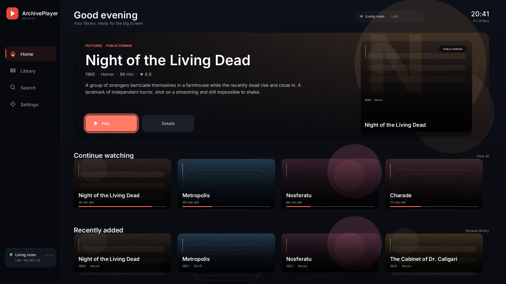
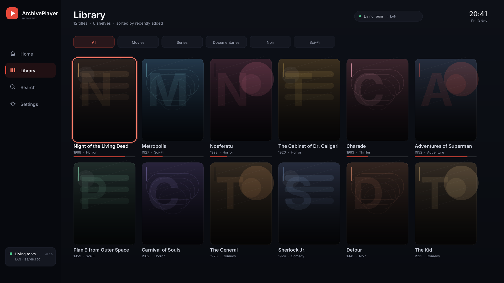
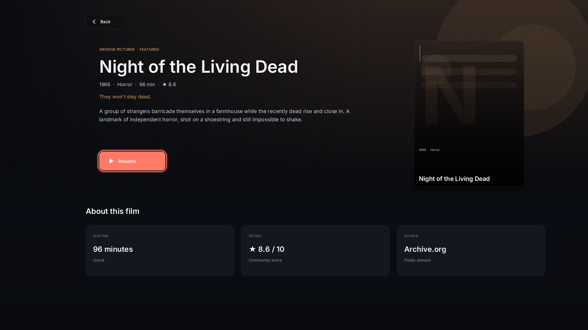
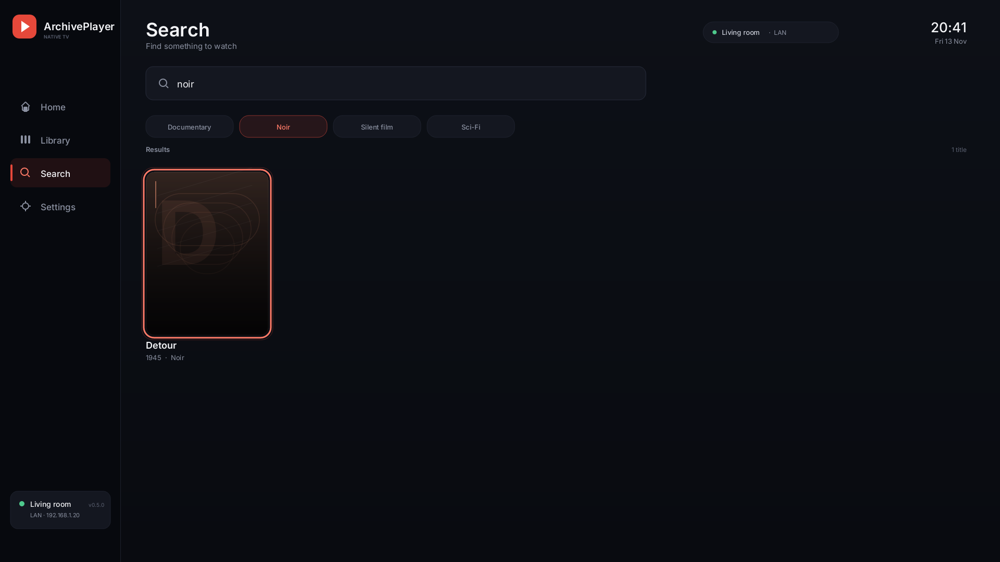
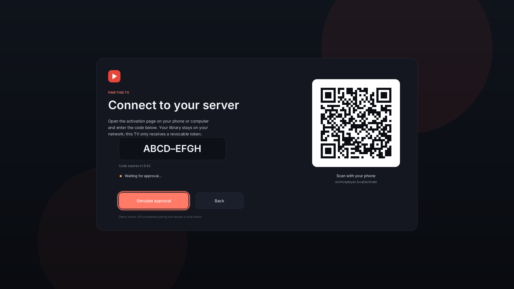
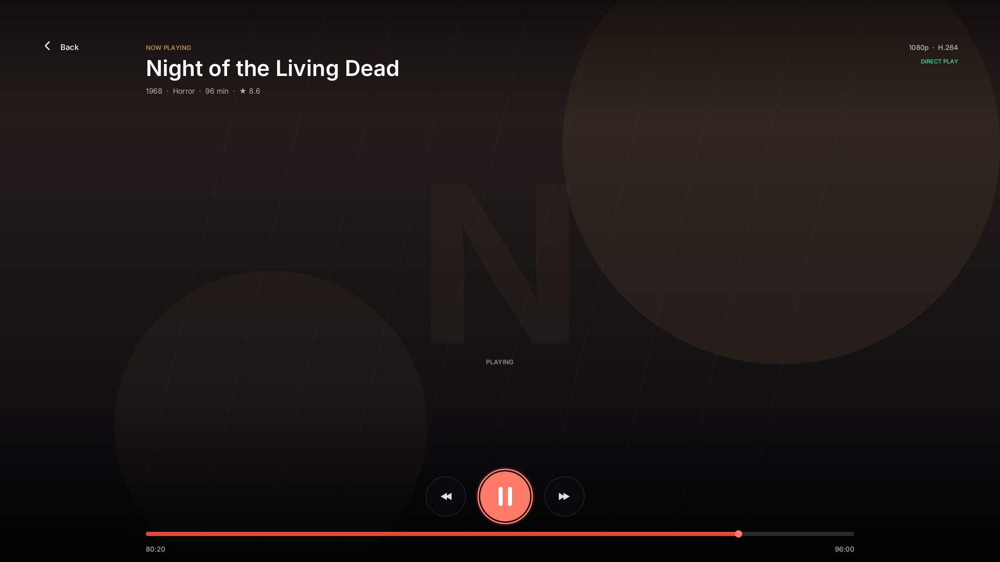

# ArchivePlayer for webOS

A native LG webOS client for [ArchivePlayer](https://github.com/LovelessCodes/ArchivePlayer),
the self-hosted Archive.org media library. It draws its own 10-foot UI with SDL2,
talks to the server over the documented HTTP API, and (in the next milestone)
hands Archive.org MP4s to the television's own media pipeline. No Chromium, no
WebView, no JavaScript runtime.

> **Status: host preview.** The native UI, focus model, demo catalogue, QR
> pairing screen, API client, and platform seams compile and run today. The
> webOS GLES2 backend and `com.webos.media` playback path still need a hardware
> spike, and this repository is not yet installable on a television.



The simulator renders the same 1920×1080 canvas the television will use:
seven screens, spatial D-pad focus, a real QR code for activation, and a
deterministic screenshot mode that runs without a display.

## Why a separate repository

- The desktop/server code is a **Rust + Tauri/Axum** workspace; this client needs
  the webOS NDK, an ARMv7 cross toolchain, SDL2, and LG's native service stubs.
- Its artifact is an unsigned `.ipk` for Developer Mode / Homebrew Channel, not a
  desktop installer or container image.
- It releases on its own cadence (`webos-v0.1.0`), against the versioned
  `apiVersion` contract rather than the server's release tag.
- Keeping the client separate makes the native toolchain and the MIT/GPL
  boundary explicit. This repository is a clean-room MIT implementation; see
  [LICENSE](LICENSE) and [NOTICE](NOTICE).

## What works now

| Area | State |
| --- | --- |
| Server URL validation (LAN HTTP, public HTTPS) | Done |
| LAN-first connect with remote fallback only on transport errors | Done |
| Bearer API client: health, status, library, continue-watching, search, playback | Done |
| Device pairing start/poll DTOs | Done |
| Playback-plan support (`platform=webos`, `file=...`) | Done |
| Startup state machine (`Setup → Pairing → Ready → Pairing` on 401) | Done |
| Token store: private file / memory | Done |
| 1920×1080 software canvas + type rendering | Done |
| SDL2 host window, D-pad focus, seven screens | Done |
| Demo library, search, detail, player, settings | Done |
| Pairing screen with a real QR code | Done (demo approval) |
| Real pairing flow wired to the UI | Not yet |
| mDNS `_archiveplayer._tcp` discovery | Interface only |
| GLES2 renderer and `com.webos.media` playback | Not yet |
| `.ipk` packaging and device install | Not yet |

## Layout

```text
crates/protocol/   serde DTOs for the server API, no I/O
crates/api/        blocking ureq client, URL policy, server targets, sessions
crates/platform/   secret-store and discovery traits + host implementations
crates/ui/         screens, theme, spatial focus navigation
crates/gfx/        software canvas, text, geometry, PNG output
crates/app/        startup state, demo catalogue, screen state and renderer
crates/sim/        SDL2 host window + headless screenshot renderer
assets/fonts/      bundled Inter (SIL OFL; see assets/fonts/LICENSE.txt)
pkg/               webOS appinfo and icons
docs/              architecture, build, protocol notes
```

## Host preview

The host build needs SDL2 (`libsdl2-dev` on Debian/Ubuntu) but not the webOS
NDK:

```sh
sudo apt-get install libsdl2-dev
cargo run -p archiveplayer-webos-sim
```

Keys: arrows move focus, Enter activates, Esc goes back, Space toggles playback
on the player screen, Q quits, F11 toggles fullscreen, and F12 writes
`screenshot.png`.

Rendered screenshots can be produced without a display:

```sh
cargo run -p archiveplayer-webos-sim -- --all docs/screenshots
cargo run -p archiveplayer-webos-sim -- --screenshot home.png --screen home
```

Checks:

```sh
cargo fmt --all --check
cargo clippy --workspace --all-targets -- -D warnings
cargo test --workspace
```

## Connecting to a server

1. Start ArchivePlayer on the LAN (`archiveplayer-server`, Docker, or the
   desktop app's server mode).
2. The client probes `GET /api/health` and refuses an `apiVersion` newer than it
   understands.
3. It starts the device flow with `POST /api/device/start` and shows the
   `userCode`/QR from the response.
4. After `POST /api/device/token` returns a token, it stores that token in a
   private app-data file and sends it as
   `Authorization: Bearer <token>`.
5. Playback calls `/api/playback/{identifier}?platform=webos` and uses
   `playbackPlan`. If `playbackPlan.compatible` is false, the UI explains why
   instead of starting a decode that will fail.

The full contract is in the server's
[docs/tv-clients.md](https://github.com/LovelessCodes/ArchivePlayer/blob/main/docs/tv-clients.md).

## Building the native package

The official webOS NDK has no x86_64 Linux build. Use macOS (Intel or Apple
silicon) or an **arm64** Linux host, install the NDK and the
`armv7-unknown-linux-gnueabi` Rust target, then set `WEBOS_NDK`. See
[docs/build.md](docs/build.md) for the toolchain, linker, and `.ipk` steps.

## Roadmap

1. Hardware spike on one webOS 5+ television: SDL2 EGL/GLES2 context, D-pad
   events, background/foreground lifecycle, exported window, and an Archive.org
   MP4 through `com.webos.media`.
2. Replace the demo catalogue with the real API: pairing poll, token store, and
   library/search/detail loading on a worker thread.
3. Add the webOS GLES2 backend and `com.webos.media` player, keeping the same
   screen state and draw calls.
4. Progress every 15 s, on pause, and on stop; completed at end.
5. mDNS discovery, Homebrew manifest, unsigned `.ipk` release.

See [docs/architecture.md](docs/architecture.md) for the design and
[docs/protocol.md](docs/protocol.md) for the API surface this client uses.

## Screens

| Home | Library |
| --- | --- |
|  |  |

| Detail | Search |
| --- | --- |
|  |  |

| Pairing | Player |
| --- | --- |
|  |  |

## Attribution

ArchivePlayer is derived from the original
[ArchivePlayer](https://github.com/JeppeKjeldal/ArchivePlayer) by **Jeppe
Kjeldal**. This client credits that work in its README, LICENSE, NOTICE, and
future Settings → About screen.

This project is not affiliated with or endorsed by LG Electronics or the Internet
Archive. Archive.org content remains subject to its own terms.
